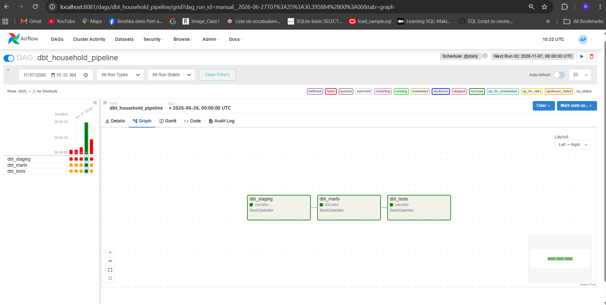
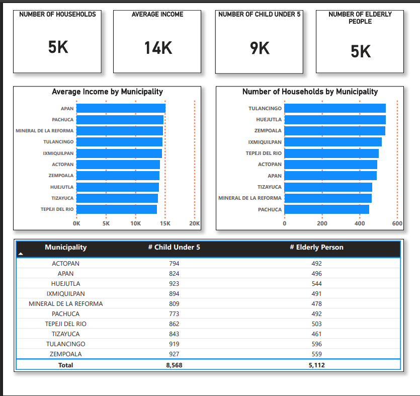

# Household-Analytics

End-to-end analytics pipeline for household data using Snowflake, dbt, and Apache Airflow, with Power BI dashboards for municipal analytics.

The project transforms household-level data stored in Snowflake into analytics-ready municipal indicators. dbt manages SQL transformations and data quality tests, while Apache Airflow orchestrates the workflow. Power BI connects to Snowflake to visualize the resulting indicators through an interactive dashboard.

The orchestration environment runs locally using Docker containers.

## Architecture

The project follows a layered analytics architecture, separating raw data, transformation models, and business-oriented analytical outputs.

### Technologies Used

- **Snowflake** – Cloud data warehouse and SQL execution engine
- **dbt** – SQL transformations, model dependencies, and data quality testing
- **Apache Airflow** – Workflow orchestration and scheduling
- **SQL** – Data transformation and aggregation
- **Power BI** – Interactive dashboards and business intelligence
- **Docker** – Containerized execution environment

### Data Pipeline Overview

The pipeline processes household data through several logical layers.

#### 1. Raw Data Layer

Raw household-level data is stored in Snowflake in the `RAW` schema.

The source table, `HOUSEHOLDS`, contains approximately 5,000 household records.

This layer serves as the source for downstream transformations.

Initial data ingestion into the raw table is performed separately and is not yet automated by the Airflow DAG.

#### 2. Data Transformation

dbt transforms the source data into structured analytical models.

The project separates data into three Snowflake schemas:

- `RAW` – Source data
- `STAGING` – Staging models and intermediate transformations
- `MART` – Aggregated data for analytical use cases

The staging model, `stg_households`, prepares the source data for downstream analysis.

The mart model, `mart_kpi_municipality`, aggregates household data by municipality.

#### 3. Analytical Data Mart

The municipal KPI model generates indicators such as:

- Number of households
- Average household income
- Number of children under five
- Elderly population

These indicators provide a structured foundation for municipal comparisons and demographic analysis.

#### 4. Data Quality

dbt tests are used to validate data quality and help identify potential issues in the analytical models.

The project includes schema-based tests and SQL-based data quality checks, including checks related to municipality values and income.

#### 5. Workflow Orchestration

Apache Airflow orchestrates the dbt workflow through the `dbt_household_pipeline` DAG.

The DAG executes three sequential tasks:

1. `dbt_staging` – Builds staging models.
2. `dbt_marts` – Builds analytical mart models.
3. `dbt_tests` – Executes dbt data quality tests.

The DAG is configured with a daily schedule.

The workflow automates transformations and testing; the initial ingestion of raw data is outside the current DAG.

#### 6. Business Intelligence

Power BI connects directly to Snowflake to visualize the municipal KPI data.

The dashboard presents household and demographic indicators, making the transformed data accessible for exploration and comparison across municipalities.

## Project Structure

The project is organized around a dbt transformation project and a separate Airflow orchestration environment.

```text
household_analytics/
│
├── models/
│   ├── staging/
│   │   ├── stg_households.sql
│   │   └── schema.yml
│   │
│   └── marts/
│       └── mart_kpi_municipality.sql
│
├── macros/
│   └── generate_schema_name.sql
│
├── tests/
│   ├── income_sanity_check.sql
│   └── positive_income.sql
│
├── airflow/
│   ├── dags/
│   │   └── dbt_pipelines.py
│   ├── Dockerfile
│   └── docker-compose.yaml
│
├── dbt_project.yml
├── packages.yml
└── README.md
```


## Example Outputs

Add screenshots of the actual project to illustrate the pipeline and its results.

### Airflow Pipeline

Show the DAG graph with the staging, marts, and testing tasks.





### Snowflake Data Warehouse

Show the schemas and the resulting municipal KPI table.

```markdown

```

### Power BI Dashboard

Show the actual municipal analytics dashboard.





## Key Skills Demonstrated

### Data Engineering

- Layered data warehouse architecture
- SQL-based data transformation
- dbt model development and dependency management
- Data quality testing
- Workflow orchestration with Apache Airflow

### Cloud Data Warehousing

- Snowflake database and schema organization
- Analytical data modeling
- Municipality-level KPI aggregation
- Warehouse-based analytical queries

### Business Intelligence

- Power BI connectivity to Snowflake
- Dashboard development
- Municipal and demographic indicator analysis
- Transformation of raw data into decision-support information

### Platform and Workflow Management

- Docker-based local development environment
- Scheduled workflow execution
- Sequential task dependencies
- Pipeline monitoring and troubleshooting

## Possible Extensions

Future improvements could include:

- Automated ingestion from CSV files, APIs, or external databases
- Automated ingestion scheduling through Airflow
- Expanded data quality rules and validation reports
- Incremental dbt models for larger datasets
- CI/CD integration for dbt testing and deployment
- Enhanced Power BI dashboards and additional municipal indicators
- Documentation and monitoring of pipeline execution

